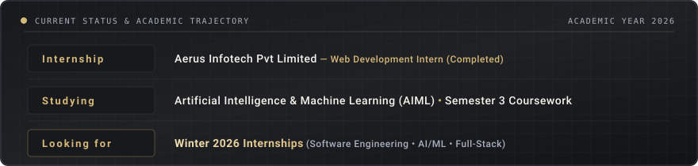
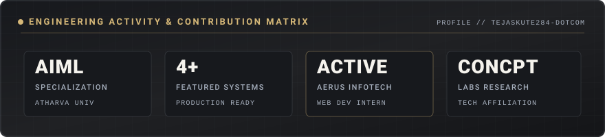
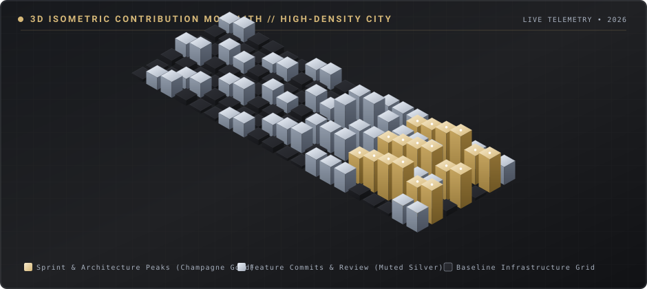
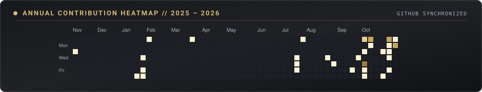

  

 

  

 

## 01. Professional Introduction

I am **Tejas Kute**, a second-year Bachelor of Technology student specializing in **Artificial Intelligence and Machine Learning (Semester 3)** at **Atharva University, Mumbai**. Having completed my **Web Development Internship at Aerus Infotech Pvt Limited** and as a technical researcher affiliated with **CONCPT Labs**, I focus on building high-reliability full-stack web platforms, investigating intelligent neural systems, and exploring modern cybersecurity architecture.

My engineering philosophy combines rigorous algorithmic thinking with clean, robust implementation. Whether designing predictive data pipelines, engineering distributed web backends, or auditing application security boundaries, I build practical software systems that translate theoretical computer science into production-grade solutions.

I am actively seeking **Winter 2026 Internships** in **Software Engineering, AI/ML, and Full-Stack Development** where I can apply my skills and collaborate on impactful real-world software.

  

 

  

---

## 02. Technical Focus

<table>
  <tr>
    <td width="33%" valign="top">
      <h3 align="center"><b>Artificial Intelligence &amp; ML</b></h3>
      
Applied deep learning, computer vision, factual reasoning algorithms, predictive modeling, and intelligent data systems.

    </td>
    <td width="33%" valign="top">
      <h3 align="center"><b>Full-Stack Engineering</b></h3>
      
Robust RESTful APIs, modern single-page applications, relational/document database schemas, and microservices architecture.

    </td>
    <td width="33%" valign="top">
      <h3 align="center"><b>Cybersecurity Exploration</b></h3>
      
Application security posture, identity &amp; access management, cryptographic verification, and tamper-resistant protocols.

    </td>
  </tr>
</table>

---

## 03. Featured Projects

### 1. **Internship Project — Enterprise Web Application Systems**
* **Organization**: Aerus Infotech Pvt Limited
* **Problem Solved**: High-concurrency client workflows and modular component architectures requiring minimal latency and strict data integrity.
* **Technical Description**: Enterprise web application platform engineering with robust client-facing interfaces, reactive state management, asynchronous REST integration, and cross-browser optimized responsiveness.
* **Key Contributors**: **Tejas Kute** &bull; **Shreya Desai** &bull; **Aaryan Raorane**
* **Contribution**: Engineered interactive frontend views, designed clean reusable UI components, and collaborated on end-to-end API integration and client-side validation logic.
* **Tech Stack**: JavaScript (ES6+), React.js, HTML5, CSS3, RESTful APIs, Git.
* **Repository**: [Aerus Infotech Internship Workspace](https://github.com/tejaskute284-dotcom)

---

### 2. **SatyaSetu — AI Credentialing &amp; Forensic Document Verification**
* **Problem Solved**: Mitigates digital certificate tampering, fraudulent academic credentials, and unverified documentation through intelligent forensic analysis.
* **Technical Description**: An intelligent credential forensics platform combining neural classification, cryptographic hash verification, and automated tamper-detection pipelines to provide instant, tamper-proof document validation.
* **Key Contributors**: **Tejas Kute** &bull; **Shreya Desai** &bull; **Aaryan Raorane**
* **Contribution**: Developed the forensic document ingestion architecture, integrated cryptographic validation mechanisms, and structured the verification REST endpoints.
* **Tech Stack**: Python, Computer Vision, FastAPI/Flask, Cryptography, RESTful APIs.
* **Repository**: [SatyaSetu Project Repository](https://github.com/tejaskute284-dotcom/SatyaSetu)

---

### 3. **CryoNex — Cold-Chain Telemetry &amp; Pharma Compliance Console**
* **Problem Solved**: Prevents temperature breaches and spoilage in cold-chain pharmaceutical shipments through unified telemetry tracking and regulatory auditing.
* **Technical Description**: A high-precision monitoring dashboard featuring interactive telemetry mapping, multi-step shipment dispatch wizards, vault security controls, and GxP regulatory compliance logging.
* **Key Contributors**: **Tejas Kute** &bull; **Shreya Desai** &bull; **Aaryan Raorane**
* **Contribution**: Implemented interactive telemetry views, automated wizard dispatch workflows, multi-role security guards, and animated data monitoring visualizations.
* **Tech Stack**: JavaScript (ES6+), Chart.js, HTML5, CSS3 / Tailwind, Map Engine, Anime.js.
* **Repository**: [CryoNex Project Repository](https://github.com/tejaskute284-dotcom)

---

### 4. **FlowState — Developer Cognitive Workflow &amp; Task Orchestrator**
* **Problem Solved**: Enhances developer deep-work efficiency by reducing context switching and intelligently structuring execution pipelines.
* **Technical Description**: A focused productivity and development orchestrator that tracks cognitive sessions, automates milestone delivery, and manages context-aware developer priorities.
* **Key Contributors**: **Tejas Kute** &bull; **Shreya Desai** &bull; **Aaryan Raorane**
* **Contribution**: Designed the state synchronization engine, modular task decomposition system, and minimal distraction-free developer interface.
* **Tech Stack**: TypeScript, React / Next.js, Node.js, Tailwind CSS, Local Persistence.
* **Repository**: [FlowState Project Repository](https://github.com/tejaskute284-dotcom/flowstate)

---

## 04. Technical Skills

<table>
  <tr>
    <td width="20%"><b>Languages</b></td>
    <td>Python &bull; Java &bull; JavaScript (ES6+) &bull; TypeScript &bull; C / C++ &bull; SQL &bull; HTML5 &bull; CSS3</td>
  </tr>
  <tr>
    <td><b>AI &amp; Machine Learning</b></td>
    <td>PyTorch &bull; Scikit-learn &bull; OpenCV &bull; NumPy &bull; Pandas &bull; Computer Vision Pipelines &bull; Model Evaluation</td>
  </tr>
  <tr>
    <td><b>Web &amp; Backend</b></td>
    <td>React.js &bull; Next.js &bull; Node.js &bull; NestJS &bull; Flask &bull; FastAPI &bull; RESTful APIs &bull; Tailwind CSS</td>
  </tr>
  <tr>
    <td><b>Databases</b></td>
    <td>PostgreSQL &bull; MySQL &bull; MongoDB &bull; Prisma ORM &bull; Structured File Storage</td>
  </tr>
  <tr>
    <td><b>Tools &amp; DevOps</b></td>
    <td>Git &bull; GitHub &bull; Docker &bull; Linux / Bash &bull; VS Code &bull; Postman &bull; Vite</td>
  </tr>
</table>

---

## 05. Experience &amp; Affiliations

* **Web Development Intern (Completed)** &mdash; *Aerus Infotech Pvt Limited*
  * Developed and tested responsive web application modules and front-end user interfaces.
  * Successfully delivered project requirements and collaborated with team members (**Shreya Desai**, **Aaryan Raorane**) on software architecture, client requirements, and interface performance.

* **Technical Researcher &amp; Contributor** &mdash; *CONCPT Labs*
  * Participated in applied technology exploration, research prototyping, and advanced software tooling investigations.

* **B.Tech in Artificial Intelligence &amp; Machine Learning** &mdash; *Atharva University, Mumbai*
  * Currently in Semester 3. Coursework: Data Structures &amp; Algorithms, Object-Oriented Programming, Database Management Systems, Discrete Mathematics, and Applied Artificial Intelligence.

---

## 06. Verified Hackathons &amp; Achievements

* **2&times; Hackathon Finalist**
  * **Atharva University Mumbai 24 Hours Hackathon &mdash; Finalist**: Engineered high-impact, time-critical software solutions under intensive 24-hour hackathon constraints.
  * **Cyber Cypher 5.0 Hackathon &mdash; Finalist**: Qualified into grand finals solving cybersecurity, algorithmic problem-solving, and system resilience challenges.
* **Smart India Hackathon (SIH) Participant / Ideator** &mdash; Team contributor on automated civic analytics and intelligent problem management platforms with collaborators.
* **Open Source Contributor &amp; Technical Builder** &mdash; Active participant in technical symposiums, hackathons, and student engineering development initiatives.

---

## 07. GitHub Contributions &amp; Statistics

  

 

  

 

  

 

---

## 08. Connect With Me

  
  &nbsp;
  
  &nbsp;
  
  &nbsp;
  

 

  

